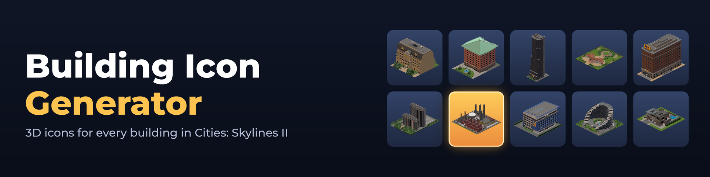

# Building Icon Generator (BIG)

A Cities: Skylines II mod that renders a high-quality 3D icon of every building —
vanilla, DLC and modded — straight from the game's packaged assets, without placing anything in a
city. Icons are generated incrementally at the main menu, kept in a registry, and shared with the
game's UI and with other mods through a small public API.

Author: **dvovo** — [Paradox Mods](https://mods.paradoxplaza.com/authors/dvovo) · [Mod page](https://mods.paradoxplaza.com/mods/163874/Windows) · [Source](https://github.com/dvovo/BuildingIconGenerator) · Developed with the help of AI · License: [MIT](LICENSE)

## Features

- **Faithful icons.** Meshes, virtual-texturing data and colour variations come from the game's own
  assets. The lot is drawn with its ground surfaces and road markings, plus the props, trees, fences
  and hedges the game places with the building. Brand and parent colours, windows, glass, water,
  metal and see-through props are handled.
- **Fast and non-blocking.** Work is spread across frames with an adaptive budget (larger while the
  main menu is idle), and only at the main menu: loading a city suspends a run at once and it
  resumes on the next visit to the menu. Texture tiles are decoded on worker threads, one mip level at the size the
  icon actually needs, and the next building is prefetched while the current one renders. On the
  test system the base game and DLC (3 429 buildings, services included) take 104 s on the first
  start and 66 s when everything is rendered again with the cache kept; a large mod collection
  added 6 984 more buildings, rendered in 147 s.
- **Incremental.** Each icon is recorded with a fingerprint of the building's composition (meshes,
  lot, sub-objects, areas, lanes) and of the content of its own model and material assets (id, size
  and date from the asset database). On every start only new buildings, icons whose fingerprint
  changed and icons deleted from the folder (also while the game runs) are rendered. Changes to
  shared props or textures only are not tracked: delete the PNG, or use *Regenerate all icons*.
- **Hardware.** Rendering runs on the GPU. Developed and timed on an NVIDIA RTX 4070 Ti with an AMD Ryzen 5 7600X; speed
  varies with the graphics card, CPU and storage.
- **Localised.** Available in the 12 languages of the game (English, German, French, Italian, Spanish, Brazilian Portuguese, Polish, Russian, Japanese, Korean, Simplified and Traditional Chinese), following the language selected in the game.
- **Reversible game integration.** An option shows the generated icons in the game's own UI instead
  of the default thumbnails; turning it off restores the originals immediately. No game file is
  ever modified. The UI gets a 128×128 thumbnail, downscaled in linear light: the size the game
  uses for its own thumbnails, which stays sharp at button size.

## Options

| Option | Default | Effect |
| --- | --- | --- |
| Generate icons automatically | On | Renders missing and out-of-date icons after the game starts, and re-renders icons deleted from the folder. |
| Use the generated icons in the game | Off | Off / Zoned and signature buildings / All buildings: replaces the thumbnails of the game's UI with the generated icons (in memory only). |
| Generate missing icons now | — | Starts an incremental run immediately (at the main menu). |
| Regenerate all icons | — | Renders every icon again. |
| Delete unused icons | — | Deletes the icons of buildings not loaded right now, and PNGs that belong to no building. |
| Open icons folder | — | Opens `ModsData/BuildingIconGenerator/icons`. |

## Files

```
%USERPROFILE%\AppData\LocalLow\Colossal Order\Cities Skylines II\ModsData\BuildingIconGenerator\
├── icons\              one 1024×1024 RGBA PNG per building + index.tsv (the registry)
│   └── thumbnails\     a 128×128 copy of each icon for the game's UI (same file name)
└── cache\              acceleration data (~3 MB), safe to delete (rebuilt automatically)
    ├── vtplans.bin     where each texture's tiles are in the game's packages
    ├── facts.bin       measured per-asset facts (texel density, alpha coverage)
    └── usage.bin       how many buildings use each asset (cache eviction order)
```

The cache is kept between runs on purpose: with it, rendering the whole catalogue again (*Regenerate
all icons*, or after deleting the icons) takes about a third less time than the first start. Deleting
it only makes the next run as slow as the first one. To render one icon again, delete its PNG; to
render everything again, use *Regenerate all icons*.

An icon's file name is the prefab name followed by `.png` (`EU_ResidentialLow01_L1_3x6.png`),
spaces, dots and accented letters included. Only names Windows cannot store as they are get a
different file name: characters Windows forbids (`\ / : * ? " < > |`) are replaced by `_`, and
those names, reserved device names (`CON`, `NUL`…) and names over 120 characters get a short hash
of the prefab name appended. When two names differ only in letter case, the one that sorts first
keeps the plain name and the other gets a hash. Use the API rather than building paths by hand.

## API for other mods

BIG shares its icons with other mods through a small public API. Your mod can show a 3D icon for any building without rendering anything itself.

### Why use the API instead of reading the folder

- **Exact match.** An icon's file is normally the prefab name plus .png, but names Windows cannot store as they are (forbidden characters, very long names, two names that differ only in letter case) get a slightly different file name, and the folder may change in future versions. The API always finds the right icon for a prefab.
- **Only finished icons.** A PNG in the folder can be missing, deleted or being rewritten at that moment. The API only reports icons that are completely written and still on disk.
- **Instant lookups.** Answers come from an in-memory index: no disk access and no folder scans, safe from any thread.
- **Notifications.** The IconUpdated event tells you when an icon is created or rewritten, so you never have to poll the folder.
- **On demand.** RequestGeneration asks BIG to render an icon your mod needs.
- **Ready for the UI.** TryGetUri and TryGetThumbnailUri return a coui:// address that the game's interface can display directly, as an image source or as UIObject.m_Icon. A file from another mod's folder cannot be shown in the UI without it. The 128 × 128 thumbnail is the size the game uses for its own thumbnails, and stays sharp at button size.
- **Stable.** ApiVersion is raised whenever a member changes meaning.

### Option 1: required dependency

Use this when your mod needs the icons to work. Players who subscribe to your mod get BIG installed automatically, and you don't ship any file of BIG with your mod.

**Step 1.** Declare BIG as a dependency in your PublishConfiguration.xml. BIG's Paradox Mods ID is 163874:

```xml
<Dependency Id="163874" />
```

**Step 2.** Copy [`Samples/BigIcons.cs`](Samples/BigIcons.cs) into your mod (change its namespace) and call it:

```csharp
if (BigIcons.TryGetThumbnailUri(prefab.name, out string uri))
{
    uiObject.m_Icon = uri;
}

BigIcons.SubscribeIconUpdated(name => Log.Info($"New icon for {name}"));
BigIcons.RequestGeneration(prefab.name);
```

That's all: no DLL to copy, reference or include.

**Alternative for step 2: a compile-time reference.** If you prefer to call BIG's classes directly, reference BuildingIconGenerator.dll from your BIG installation with Private set to false. The compiler uses it only to check your code; nothing is copied into your mod, and in the game your mod uses the copy installed with BIG.

```xml
<Reference Include="BuildingIconGenerator">
    <HintPath>path\to\BuildingIconGenerator.dll</HintPath>
    <Private>false</Private>
</Reference>
```

```csharp
using BuildingIconGenerator.Api;

if (BuildingIcons.TryGetThumbnailUri(prefab, out string uri))
{
    uiObject.m_Icon = uri;
}

BuildingIcons.IconUpdated += name => Log.Info($"New icon for {name}");
```

With this alternative the dependency of step 1 is required: without BIG installed, your mod would fail to load.

### Option 2: optional integration

Use this when your mod works on its own and only shows icons if BIG happens to be installed. Do step 2 with BigIcons.cs and skip step 1: without BIG, every call simply reports that there is no icon.

### API reference

Class BuildingIconGenerator.Api.BuildingIcons. Every lookup takes the prefab name (PrefabBase.name) or the prefab itself.

- **TryGetPath(name, out path)**: full path of the building's PNG.
- **TryGetUri(name, out uri)**: UI address (coui://buildingicons/...?v=...), usable as an image source or as UIObject.m_Icon once UriAvailable is true. The v parameter changes when the icon is rewritten, so the UI never shows a stale copy.
- **TryGetThumbnailUri(name, out uri)** / **TryGetThumbnailPath(name, out path)**: the same for the 128 × 128 thumbnail (coui://buildingicons/thumbnails/...). Use it for anything shown at button size, such as UIObject.m_Icon: the game's UI draws images without mipmaps, so the full-size icon shrunk that much looks jagged.
- **HasIcon(name)** / **TryGetWriteTime(name, out utc)**: whether the icon exists, and when it was written.
- **GetAll()** / **Count** / **Folder**: every building with an icon, how many, and where they are.
- **IsAvailable** / **UriAvailable** / **IsGenerating**: index loaded, UI address mapped, a run in progress.
- **RequestGeneration(name)**: asks for the icon to be rendered at the next opportunity, at the main menu with automatic generation on.
- **IconUpdated** (event): raised on the main thread after an icon is written, with the prefab name.
- **ApiVersion**: raised whenever a member changes meaning.


## Building from source

Requirements: Visual Studio 2022, the Cities: Skylines II modding toolchain (`CSII_TOOLPATH`),
and Unity 2022.3.62f2 for the shaders.

1. **Shaders.** Open the `Shaders` folder as a Unity project and run
   *Building Icon Generator ▸ Build shader bundle*. The bundle is copied to
   `BuildingIconGenerator/Bundles/building_icon_shaders`. Only needed when a shader changes.
2. **Mod.** Open `BuildingIconGenerator.sln` and build. The toolchain deploys the mod to the game's
   local mods folder.

## Publishing

The text of the Paradox Mods page lives in `DESCRIPTION.md` and is copied (XML-escaped) into the
`LongDescription` of `BuildingIconGenerator/Properties/PublishConfiguration.xml`. Paradox Mods
renders a subset of Markdown: headings, bold text, bullet and numbered lists and plain
URLs. Images for the page are in `Branding/`: the square thumbnail (`Properties/Thumbnail.png`,
1024×1024) and six 1920×1080 gallery images (`Properties/Screenshots/`).

The mod is published on Paradox Mods with ModId **163874**, already set in `PublishConfiguration.xml`.
**PublishNewMod** must not be used again: it would create a second mod.

1. Text, images or visibility: edit `DESCRIPTION.md` (and copy it into `LongDescription`) or
   `PublishConfiguration.xml`, then run **UpdatePublishedConfiguration**. No code is uploaded.
   Paradox Mods does not format code blocks and drops anything between angle brackets, so the
   description describes code in words and links to this README for the examples.
   Do not put GitHub links in the description: with `https://github.com/...` links in it, Paradox
   Mods rejects the update with "Network response was invalid". The description refers to the
   GitHub button of the page instead, which is the `ExternalLink`.
2. Code changes: raise `ModVersion`, update `ChangeLog` and use **PublishNewVersion**.

## Repository layout

```
BuildingIconGenerator.sln
BuildingIconGenerator/              the mod
├── Mod.cs                          entry point
├── ModPaths.cs                     data folders
├── Api/BuildingIcons.cs            public API
├── Settings/ModSettings.cs         options page
├── Localization/ModLocale.cs       strings in the game's 12 languages
├── Integration/GameIconOverrides.cs  reversible replacement of the game's icons
├── Systems/IconGeneratorSystem*.cs   the generator (one partial file per concern)
├── Rendering/                      capture rig, colour bake, ground composition, shader bundle
├── Textures/FastVtLoader.cs        virtual-texturing tile decoder (worker threads)
├── Geometry/                       mesh repair and clipping, polygon fill
├── Scheduling/                     generation order, cache eviction order
└── Storage/                        icon registry and persistent indexes
Shaders/                            Unity project with the shader sources
Branding/                           mod icon, thumbnail, banner, gallery and social images
DESCRIPTION.md                      text of the Paradox Mods page
Samples/BigIcons.cs                 optional-integration client for other mods (no reference needed)
```

## How it works

1. **Catalogue.** Every prefab with `BuildingData` or `BuildingExtensionData` and geometry
   (placeholders excluded) is listed; `SpawnableBuildingData` marks the zoned and signature ones. Each is
   fingerprinted (meshes, lot, sub-objects, sub-areas, sub-lanes, and the id, size and date of
   its own model and material assets). The registry (`icons/index.tsv`)
   says which icons are current.
2. **Order.** Pending buildings are grouped into families and ordered greedily so consecutive
   buildings share atlases, props and meshes, which the run caches then find already loaded.
3. **Scene.** For each building: its meshes, sub-objects (recursively, with probabilities, random
   groups, placeholders and object states resolved as the game does) and lanes, each with the
   colours of the object it belongs to.
4. **Textures.** One mip level per texture, chosen from the building's texel density and the
   framing. Tiles are read straight from the game's packages and zstd-decoded on worker threads.
5. **Materials.** HDRP/Lit materials with the colour variation baked into the albedo on the GPU.
6. **Ground.** Lot surfaces and ground decals are composed on the GPU into one texture.
7. **Capture.** Two renders (over black and over white) recover a true alpha channel; the result is
   composed on the GPU, read back asynchronously and written as PNG on a worker thread, together
   with a 128×128 thumbnail for the UI (8×8 blocks averaged in linear light, weighted by alpha).
